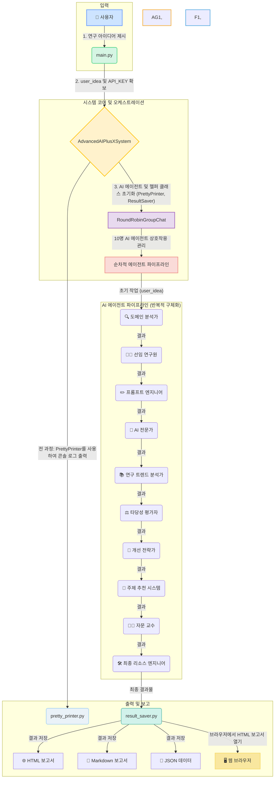

🚀 Jarvis: AI-Powered Research Acceleration Framework
Executive Summary
Jarvis is an autonomous multi-agent framework that transforms a single research idea into a comprehensive, actionable plan in minutes, not weeks. By simulating a collaborative team of 10 specialized AI agents, this system automates the entire initial R&D lifecycle—from ideation and feasibility analysis to final reporting. It dramatically reduces manual effort, mitigates initial planning risks, and empowers researchers to focus on innovation and execution.

Key Outcomes & Value Proposition
This project demonstrates the ability to architect and deploy sophisticated AI systems that deliver tangible value.

⚡️ Drastic Efficiency Gains: Automates hundreds of hours of manual work typically required for initial research, literature review, and planning.

🎯 High-Quality, Data-Driven Insights: Leverages a team of AI specialists to provide a 360-degree analysis, ensuring that research plans are well-vetted, innovative, and grounded in current trends.

📊 End-to-End Automation: Manages the entire workflow autonomously, culminating in the automatic generation of multi-format reports (HTML, JSON, Markdown) ready for review and distribution.

💡 De-risked Innovation: Identifies potential challenges, research gaps, and feasibility issues early in the process, allowing for smarter, more strategic decision-making.

How It Works: The Automated Collaboration Flow
The framework operates as a sequential pipeline where each AI agent builds upon the work of the previous one, creating a coherent and progressively refined output.

Technical Stack & Project Structure
This project showcases expertise in building modular and scalable AI systems.

Core Technologies: Python, Autogen (Multi-Agent Framework), OpenAI/Google Gemini APIs.

Key Skills: LLM Orchestration, Autonomous Workflows, System Design, Automated Reporting.

**Project Structure:**
.
├── 📂 research_results/     # Output folder for all generated reports (HTML, JSON, Markdown)
│   ├── html/
│   ├── json/
│   └── markdown/
├── 📜 ai_system.py          # Core logic: Defines the 10 AI agents, their roles, and orchestrates their interactions.
├── 📜 main.py               # Application entry point: Handles user input and initializes the AI system.
├── 📜 pretty_printer.py     # Console output: Formats and prints agent responses and progress updates.
├── 📜 research_domain.py    # Data model: Defines research field classifications (Enum).
├── 📜 result_saver.py       # File I/O: Saves analysis results to JSON, Markdown, and HTML formats. Also opens the HTML report.
└── 📜 requirements.txt      # Dependencies: Lists necessary Python libraries (see details below).

**Dependencies (`requirements.txt`):**
The `requirements.txt` file lists all Python libraries needed to run this project. Key libraries include:
- `ag2`, `autogen-agentchat`, `autogen-ext`: For building and managing the multi-agent system. `autogen-ext[openai]` specifically enables the use of OpenAI-compatible APIs like Google's Gemini.
- `rich`: For creating rich, formatted text and tables in the console output.
- `nest-asyncio`: To allow asyncio to run in environments like Jupyter notebooks or standard Python scripts where an event loop might already be running.

Getting Started
1. Installation
Clone the repository and install the required dependencies.

git clone [https://github.com/your-repo/jarvis-research-system.git](https://github.com/your-repo/jarvis-research-system.git)
cd jarvis-research-system
pip install -r requirements.txt

2. API Key Configuration (⭐Crucial⭐)
Open main.py and set your Google Gemini API key.

# main.py
GOOGLE_API_KEY = "YOUR_API_KEY_HERE"  # <-- ⭐⭐⭐ PASTE YOUR GEMINI API KEY HERE! ⭐⭐⭐

3. Running the System
Execute the main script from your terminal.

python main.py

You will be prompted to enter a research idea. The system will take over from there, providing real-time updates and opening the final HTML report in your browser upon completion.

The AI Expert Team
Jarvis simulates a high-performance R&D team with the following 10 specialists:

Emoji

Agent Role

Core Responsibility

🔍

Domain Classifier

Identifies the core scientific or technical domain.

👨‍🏫

Senior Researcher

Refines the raw idea into a concrete research concept.

✏️

Prompt Engineer

Sharpens research questions to be precise and testable.

🤖

AI Specialist

Designs the AI-powered technical approach.

📚

Research Trend Analyst

Scans recent literature for trends, novelty, and gaps.

⚖️

Feasibility Evaluator

Provides a verdict on technical and practical viability.

🔧

Improvement Strategist

Identifies and proposes solutions for weaknesses.

🎯

Topic Recommender

Suggests 5 specific, high-potential research topics.

👨‍🏫

Advisor Professor

Conducts a final review for academic/scientific rigor.

🛠️

Final Resource Engineer

Packages all findings into a complete resource kit.
